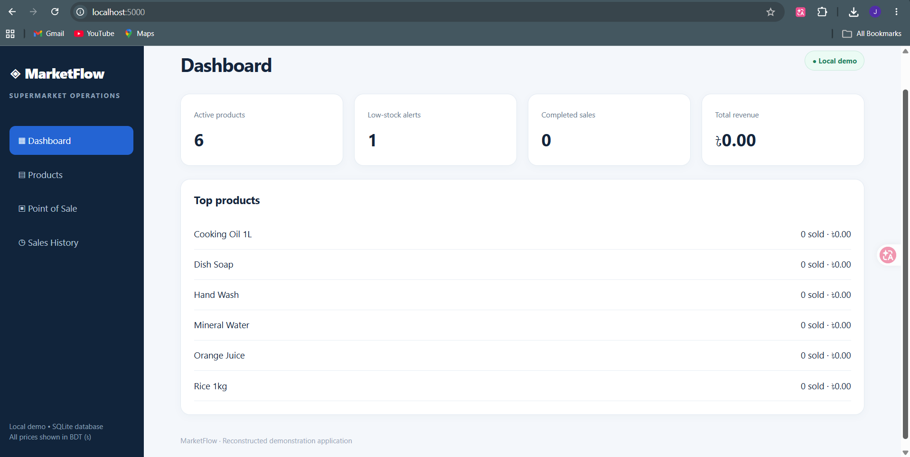
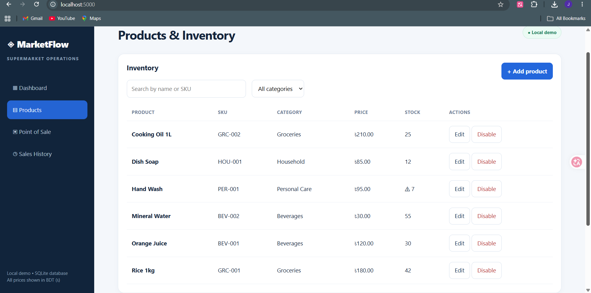
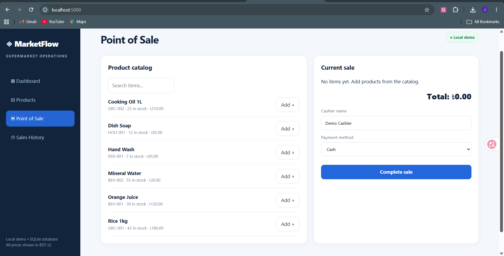
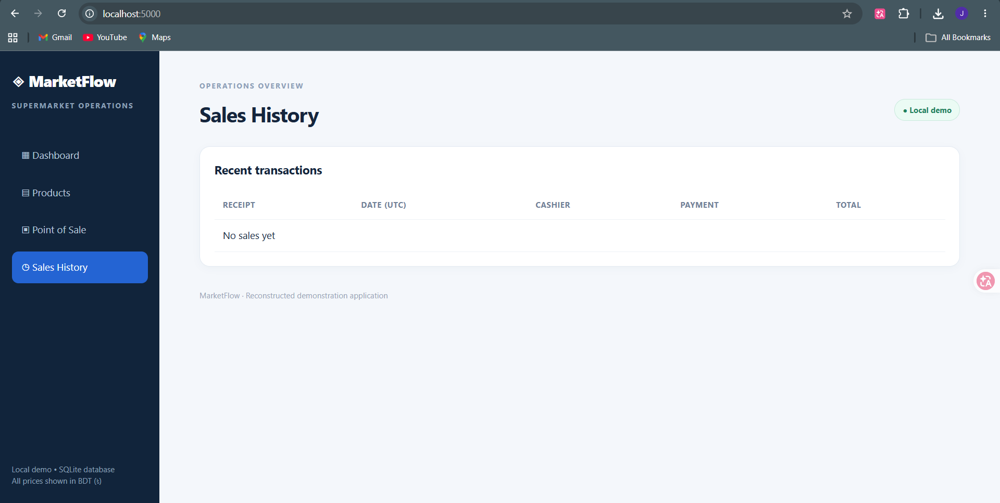
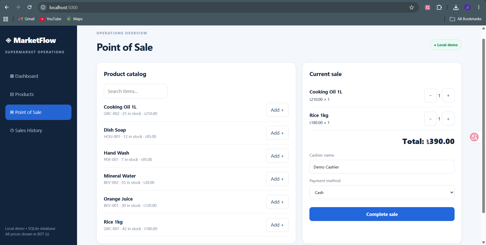
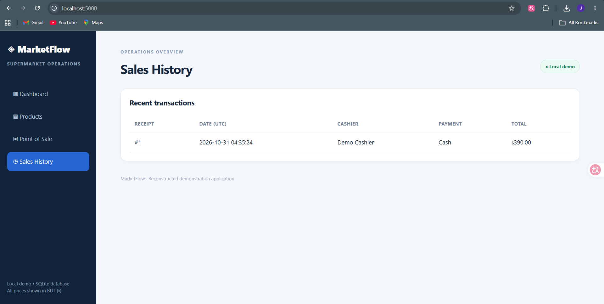

# MarketFlow — Supermarket Management System

A **locally tested reconstructed demo** based on an earlier Supermarket Management System project report. The original application source code was unavailable; this repository contains a new implementation of its core workflows, not a recovered copy of the original code.

## Features

- Responsive dashboard with inventory, low-stock and revenue metrics
- Product and category creation; product editing and soft disabling
- Searchable cashier catalog and shopping cart
- Transactional checkout with stock validation and inventory deduction
- Recent sales history and top-product reporting
- SQLite persistence, seeded demo catalog, and parameterized SQL

## Tech stack

**C# · ASP.NET Core 8 Minimal API · Microsoft.Data.Sqlite · HTML/CSS/JavaScript**

The original report described a Blazor + SQL Server architecture. This smaller reconstruction uses a dependency-light ASP.NET Core API and SQLite so it can run locally without a SQL Server installation.

## Run locally

1. Install the [.NET 8 SDK](https://dotnet.microsoft.com/download/dotnet/8.0).
2. In a terminal, run:

   ```bash
   cd src/MarketApp
   dotnet restore
   dotnet run
   ```
3. Open the **localhost** address shown in the terminal (typically `http://localhost:5000` or another assigned port).
4. Use **Products** to manage inventory and **Point of Sale** to record a sale. Demo products are added automatically on first launch.

Data is stored in `src/MarketApp/market.db` and excluded from Git. Delete this database while the app is stopped to reset the sample data.

## Application screenshots

The screenshots below were captured from the running local application.

### Dashboard


### Products and inventory


### Point of sale


### Sales history


### Checkout cart


### Completed transaction


## API routes

| Method | Route | Purpose |
|---|---|---|
| GET | `/api/dashboard` | Overview metrics |
| GET / POST | `/api/categories` | List / create categories |
| GET / POST | `/api/products` | List / create products |
| PUT / DELETE | `/api/products/{id}` | Update / soft-disable product |
| POST | `/api/sales` | Checkout (atomic inventory update) |
| GET | `/api/sales` | Recent sales |
| GET | `/api/reports/top-products` | Product performance |

## Verification

The application was launched locally on Windows and its dashboard, product catalog, point of sale, and sales history pages were displayed. A sample checkout totaling ৳390 appeared in sales history as receipt #1. Automated tests and full coverage of all edit/stock scenarios have not yet been completed.

## Scope and limitations

This is a **local portfolio demonstration**, not production POS software. It does not implement authentication, user roles, receipts, taxes, payment processing, audit logs, or SQL Server deployment. Do not expose it to the public internet without implementing authentication, authorization, validation hardening, and production deployment controls.

## Project background

The earlier project report covered category and product management, sales, inventory, reporting, database design, and access control. This repository rebuilds a practical subset of those workflows in a new codebase. If the earlier work was a group project, retain appropriate team attribution when publishing.
